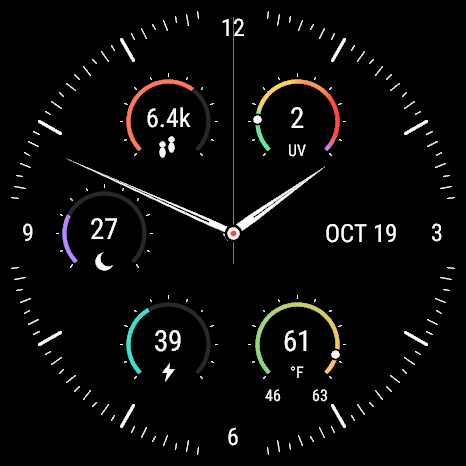

# Sector

An open-source analog Garmin watch face: a black AMOLED dial, white hands and markers, and six useful complications. Install it over a USB cable—no Connect IQ Store listing required.

The preview uses simulator data, not personal health readings.

**[Download Sector.prg](https://github.com/loganthorneloe/sector-watchface/raw/refs/tags/v1.1.8/install/Sector.prg)** · **[Cable-install guide](docs/INSTALL.md)** · **[Build and fork](docs/DEVELOPMENT.md)**

## Compatibility

The included v1.1.8 binary targets **fēnix 9 Pro inReach, 51 mm AMOLED**, device ID `fenix9pro51mm`, 466 × 466 pixels. It has been tested in the matching Garmin simulator and transferred to that physical watch. Other sizes and models are **not supported by this binary**, even if their screens look similar. Forks can add and test their own targets.

The manifest requires Connect IQ API 5.1.0 or later. Sleep Score requires the native complication introduced in API 6.0.2 and firmware that provides it. Unavailable values show `--`; the face never substitutes a made-up score.

Version 1.1.8 fixes weather disappearing after overnight sleep by displaying Garmin’s latest supplied conditions without an extra age cutoff. The larger text, outlined hands, and thin red second hand are unchanged.

## On the dial

| Position | Complication | Behavior |
| --- | --- | --- |
| Upper left | Steps | Coral progress toward your watch’s daily step goal |
| Middle left | Sleep Score | Purple, 0–100, moon icon |
| Lower left | Body Battery | Teal, 0–100, lightning icon |
| Upper right | UV index | Integer readout, green-to-purple scale and sliding marker |
| Middle right | Date | Plain text, e.g. `OCT 19` |
| Lower right | Temperature | Current reading, °F/°C, daily low and high, dynamic gradient and sliding marker |

Temperature spans **today’s low to today’s high**. Colors depend on the actual temperatures: a 46–63°F day runs green to amber; hotter days shift toward orange and red. The palette is a visual design choice, not a health or weather warning scale. UV uses the standard category colors.

The red second hand appears while the display is awake. Low-power/off mode is completely black; this design does not provide an always-on face. Wrist-gesture detection and screen timeout are controlled by the watch. Fahrenheit is the default; source settings also support Celsius and watch-preferred units.

## Install in a minute

1. Confirm your exact watch model matches the compatibility section.
2. Download **Sector.prg** using the link above, or get it from [`install/`](install/). The matching checksum is in [`install/SHA256SUMS`](install/SHA256SUMS).
3. Connect with a USB **data** cable and select **MTP / File Transfer** on the watch if prompted.
4. Copy `Sector.prg` into the watch’s existing **`GARMIN/APPS`** folder.
5. Wait for the transfer to finish, eject if available, disconnect, and select **Sector** in the watch-face picker.

Windows can use File Explorer. macOS needs an MTP client when the watch is in MTP mode; Finder will not show that storage. Linux can use an MTP-capable file manager. See the [full guide](docs/INSTALL.md) for platform steps, updates, checksums, and troubleshooting.

You do not need the Garmin SDK, a developer account, or a signing key to install the prebuilt file. Garmin’s SDK is needed only to build your own version.

## Data and privacy

Sector reads steps/goals, Body Battery, Sleep Score, and Garmin’s cached weather on the watch. It does not make network requests, request GPS fixes, collect analytics, or send health data to a server. Weather availability depends on Garmin’s own weather synchronization.

Body Battery uses the native current-value complication, with a fallback to valid history from the last two hours. Sector displays Garmin's latest supplied weather directly, without a separate age cutoff or retained fallback. Missing data shows `--`. Garmin controls the freshness of its weather cache; Sector does not request weather from an external provider. Metrics refresh at most every 30 seconds during regular awake updates; waking or changing settings can refresh immediately. Drawing follows Garmin’s native watch-face callbacks.

The only requested permissions are `SensorHistory` and `ComplicationSubscriber`. This repository includes source, original face assets, a simulator preview, tests, documentation, and the signed release program. It does **not** include private signing keys, Garmin account files, device backups, device identifiers, SDK files, or personal health records. A program signature is public verification data, not the private signing key.

## Make it yours

Fork the repo, follow [DEVELOPMENT.md](docs/DEVELOPMENT.md), and build with your own developer key. Use a new application UUID for an independently distributed fork so it can coexist with Sector. Model ports, layout improvements, and bug fixes are welcome. Include the model, firmware/API version, and reproduction steps with a report; remove personal information from screenshots or logs.

## Validation

Version 1.1.8 compiles with Connect IQ SDK 9.2.0. All ten simulator tests pass, covering step progress, temperature conversion and range, formatting, Body Battery fallback validity, color interpolation, overnight weather, unavailable/partial weather, and updated provider readings. The unchanged dial layout was visually checked in the 466 × 466 target simulator; the v1.1.8 USB transfer was verified by reading the file back. Wider model support and long-term battery consumption have not been established.

## License

[MIT](LICENSE). You may use, modify, fork, and redistribute the project under that license. Garmin, fēnix, Connect IQ, and Body Battery are Garmin trademarks; this is an independent project, not an official Garmin product. Garmin’s SDK and other third-party tools retain their own licenses and are not redistributed here.

## References

- [Garmin Connect IQ developer documentation](https://developer.garmin.com/connect-iq/)
- [Garmin Weather API](https://developer.garmin.com/connect-iq/api-docs/Toybox/Weather/CurrentConditions.html)
- [Garmin Complications API](https://developer.garmin.com/connect-iq/api-docs/Toybox/Complications.html)
- [EPA UV index scale](https://www.epa.gov/sunsafety/uv-index-scale-0)
