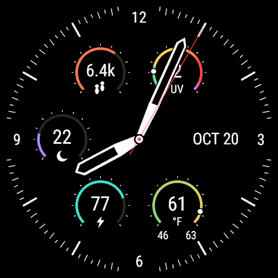
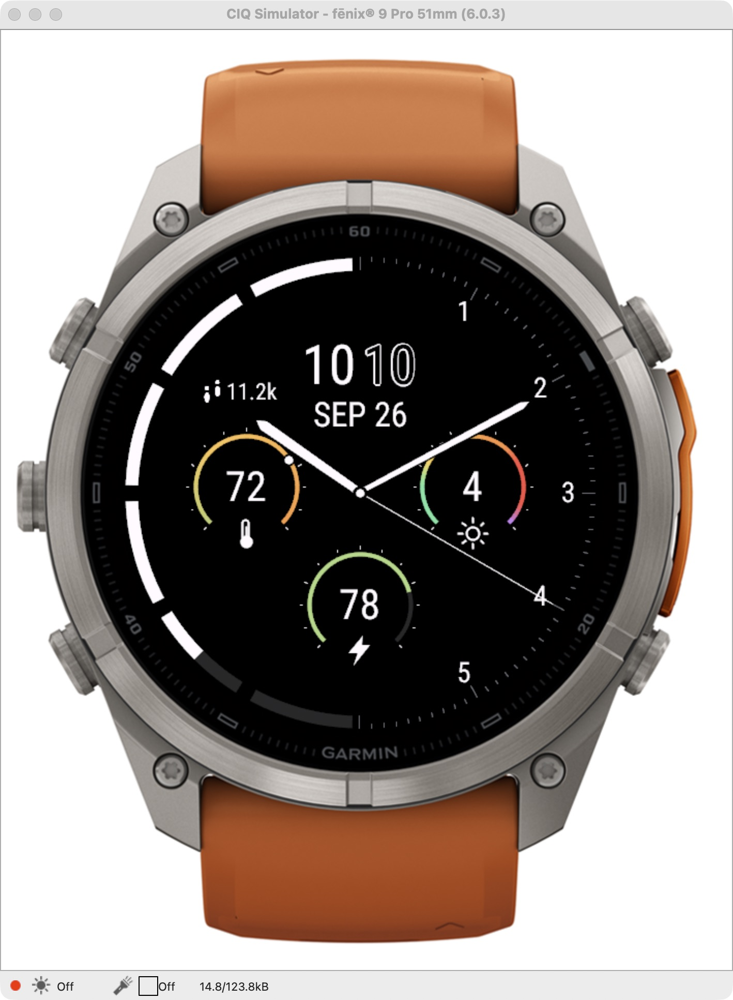

# Garmin Watch

Two open-source Garmin watch faces: **Sector** and **Ember**. Each has its own source, tests, documentation, and installable release. They have different application IDs and can be installed together.

| Sector | Ember |
| --- | --- |
|  |  |
| Analog dial with steps, Sleep Score, Body Battery, UV, date, and temperature. | Analog/digital dial with weather, UV, Body Battery, steps, and right-side hour numerals. |
| [About Sector](faces/sector/) · **[Download Sector.prg](https://github.com/loganthorneloe/garmin-watch/raw/refs/heads/main/faces/sector/install/Sector.prg)** | [About Ember](faces/ember/) · **[Download Ember.prg](https://github.com/loganthorneloe/garmin-watch/raw/refs/heads/main/faces/ember/install/Ember.prg)** |
| Version 1.1.8 | Version 1.1.9 |

Previews use synthetic simulator readings, not personal health data.

## Compatibility and installation

Both included releases target **fēnix 9 Pro inReach, 51 mm AMOLED** (`fenix9pro51mm`, 466 × 466). These binaries are not intended for other watch models. Both have been transferred to that model and verified by reading the files back over USB.

1. Download either or both `.prg` files above.
2. Connect the watch with a USB data cable and choose MTP / File Transfer if prompted.
3. Copy the files into the watch's existing `GARMIN/APPS` folder.
4. Finish the transfer, disconnect, and choose **Sector** or **Ember** in the watch-face picker.

On macOS, use an MTP client; Finder does not expose MTP storage. Windows and Linux can use an MTP-capable file manager. You do not need the Garmin SDK to install the supplied releases. See the [USB installation guide](faces/sector/docs/INSTALL.md) for platform details; use `Ember.prg` in place of `Sector.prg` when installing Ember. Each face's `install/SHA256SUMS` contains its release checksum.

Both faces use a black display in low-power/off mode rather than an always-on dial. Garmin supplies the activity and weather readings. Neither face makes external network requests or uploads health data.

## Source and builds

```text
faces/sector/    Sector source, resources, tests, documentation, and release
faces/ember/     Ember source, resources, tests, documentation, and release
scripts/build.sh  Build either face from the repository root
```

Requires Garmin Connect IQ SDK 9.2.0, its `fenix9pro51mm` device package, and Java 17 or later.

```sh
git clone https://github.com/loganthorneloe/garmin-watch.git
cd garmin-watch
export CIQ_SDK="/path/to/connect-iq-sdk"
# Set CIQ_JAVA if Java is not on PATH.
# Set CIQ_KEY to reuse your private signing key.
./scripts/build.sh sector fenix9pro51mm release
./scripts/build.sh ember fenix9pro51mm release
```

Build output lives under each face's `build/` folder. Each face's own `scripts/build.sh` also works directly. If no key is supplied, the build script creates a private signing key inside that face's ignored `.private/` directory. Keep your key private and reuse it for your updates. Use a new application ID for independently distributed forks.

For simulator tests, use `test` instead of `release`, then run the resulting program with `monkeydo ... fenix9pro51mm -t`. Ember also supports `preview`, with fixed sample readings for screenshots. Never install a test or preview program as your daily watch face.

See [Sector development](faces/sector/docs/DEVELOPMENT.md) and [Ember build and validation](faces/ember/README.md#build) for details. Existing Sector release tags retain their original repository layout.

## License

[MIT](LICENSE). Garmin, fēnix, Connect IQ, and Body Battery are Garmin trademarks; this is an independent project. Private signing keys, device backups, Garmin SDK files, and personal health records are not included.
